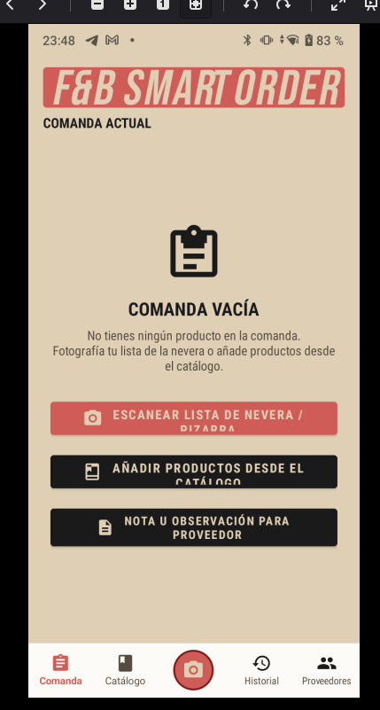
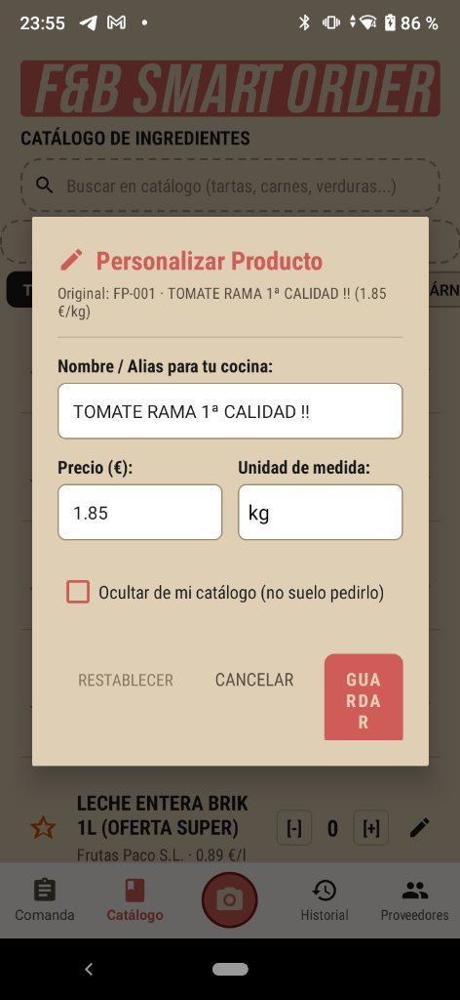
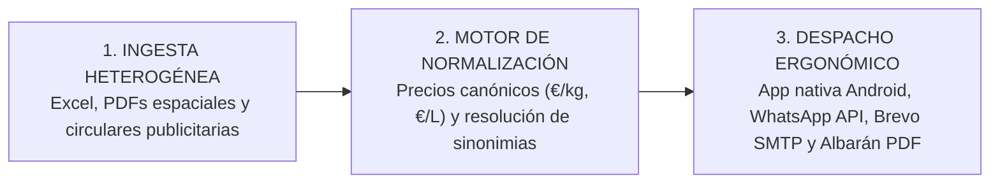
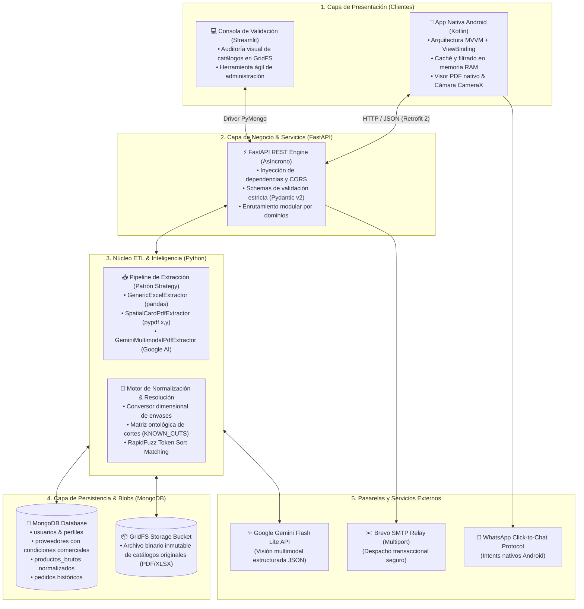

# F&B SmartOrder 🍽️📦

> **Sistema Multiplataforma para la Estandarización de Catálogos de Proveedores, Comparación de Tarifas y Automatización de Comandas en Hostelería**  
> *Proyecto de Fin de Ciclo (TFC) · Desarrollo de Aplicaciones Multiplataforma (DAM)*

[](https://developer.android.com/kotlin)
[](https://fastapi.tiangolo.com/)
[](https://www.python.org/)
[](https://www.mongodb.com/)
[](https://ai.google.dev/)
[](https://www.brevo.com/)
[](https://appetize.io/app/b_vzk4mwwquy427so44ogxpch7m4)
[](https://github.com/electorado/Smartorder_HORECA/releases)

> 🚀 **¡Prueba la aplicación ahora mismo sin instalar nada!**  
> Puedes ejecutar la app en un teléfono virtual directamente en tu navegador web a través de **[▶️ Demo Interactiva en Appetize.io](https://appetize.io/app/b_vzk4mwwquy427so44ogxpch7m4)** (conectada en tiempo real al backend en la nube).  
> Si tienes un dispositivo Android, descarga el paquete instalador listo para usar desde **[GitHub Releases](https://github.com/electorado/Smartorder_HORECA/releases)**.

---

## 📱 Galería de la Aplicación (Visual Showcase)

<!-- 
==================================================================================
GUÍA DE CAPTURAS: 
Crea una carpeta llamada 'art/' en la raíz del repositorio y guarda allí estas 4 imágenes.
Puedes usar las capturas que ya tienes generadas en tu carpeta 'scratch/android_screenshots/'.
==================================================================================
-->

| 1. Catálogo & Comparativa (€/kg) | 2. Escaneo Multimodal con IA | 3. Checklist de Despacho | 4. Albarán Oficial en PDF |
| :---: | :---: | :---: | :---: |
|  |  |  |  |
| *Búsqueda en memoria RAM, ordenación por mejor precio canónico y selectores táctiles.* | *Digitalización de notas manuscritas con Gemini Flash Lite e inferencia taxonómica.* | *Desglose de subpedidos por distribuidor con Intents directos a WhatsApp y Email.* | *Generación y visor nativo (PdfRenderer) de la comanda formal del restaurante.* |

> <!-- INSTRUCCIÓN DE ARCHIVOS: 
>   Para que se vean en GitHub, copia tus capturas con estos nombres dentro de la carpeta 'art/':
>   - art/01_catalogo_ofertas.png   <- Captura del catálogo con productos y precios
>   - art/02_escaneo_gemini.png      <- Captura del escaneo o digitalización de notas
>   - art/03_checklist_despacho.png  <- Captura del diálogo modal "Checklist de Despacho"
>   - art/04_albaran_pdf.png         <- Captura de la pantalla del Albarán en PDF
> -->

---

## 📋 Índice de Contenidos

1. [El Manifiesto: Del Turno de Cocina al Código](#-el-manifiesto-del-turno-de-cocina-al-código)
2. [Propuesta de Valor & Solución](#-propuesta-de-valor--solución)
3. [Arquitectura del Sistema (Clean & Decoupled)](#-arquitectura-del-sistema)
4. [Patrones de Diseño Implementados](#-patrones-de-diseño-implementados)
5. [Decisiones de Ingeniería y Trade-Offs (ADR)](#-decisiones-de-ingeniería-y-trade-offs-adr)
6. [Estructura del Repositorio](#-estructura-del-repositorio)
7. [Puesta en Marcha & Ejecución Rápida](#-puesta-en-marcha--ejecución-rápida)
8. [Credenciales Demo para Evaluación](#-credenciales-demo-para-evaluación)
9. [Matriz Tecnológica](#-matriz-tecnológica)
10. [Autoría y Créditos](#-autoría-y-créditos)

---

## 🔪 El Manifiesto: Del Turno de Cocina al Código

> *Son la una de la madrugada. El servicio de cenas ha terminado, las partidas están limpias y el cuerpo pesa tras diez horas de calor entre fuegos y comandas. Pero la jornada de un jefe de cocina no acaba ahí: queda revisar las cámaras frigoríficas con una libreta arrugada, mirar una pizarra llena de anotaciones apresuradas y descifrar las ofertas que cuatro o cinco distribuidores han enviado por WhatsApp y correo electrónico.*
>
> *Un comercial manda una hoja de Excel llena de códigos internos; otro manda un PDF publicitario maquetado con ofertas por cajas de varios kilos; un tercero avisa de una oferta por mensaje de voz. Intentar comparar de cabeza si es más rentable el lomo a 61,90 € por caja de 3,6 kg o el del competidor a 17,50 €/kg a esas horas de la noche es lento, agotador y propenso al error humano.*

**F&B SmartOrder** nace en primera persona desde el corazón de las cocinas profesionales. No es un ejercicio abstracto de laboratorio: es la respuesta de la ingeniería de software moderna a la fragmentación, el desorden de formatos y la pérdida económica invisible en el sector de la hostelería independiente.

---

## 💡 Propuesta de Valor & Solución

El sistema unifica el ciclo completo de compras diarias a través de tres pilares:



1. **Estandarización Dimensional Automática:** Descompone envases complejos (`"caja 16uds x 0,2kg"`, `"lata 5kg"`, `"botella 750ml"`) calculando el **precio unitario real comparable** (€/kg o €/L).
2. **Entity Resolution Taxonómico:** Mediante algoritmos de distancia de Levenshtein y afinidad semántica (*RapidFuzz*), discrimina cortes nobles (*Solomillo de Ternera*) de cortes accesorios (*Chuletero con Solomillo*), impidiendo cruces falsos.
3. **Visión Multimodal Asistida por IA:** El cocinero toma una fotografía con la cámara de su móvil a la lista manuscrita de la cámara o de la pizarra; la IA de Google Gemini extrae, cuantifica y mapea los ingredientes contra el catálogo en segundos.
4. **Despacho Multiproveedor sin Errores:** La comanda global se descompone automáticamente en subórdenes por proveedor, dotadas de un **Checklist Modal interactivo** que guía al usuario en el envío por WhatsApp y por correo electrónico (vía Brevo SMTP Relay), culminando con la emisión de un albarán formal en PDF.

---

## 🏛️ Arquitectura del Sistema

El ecosistema se rige por una **Arquitectura en Capas Desacoplada** (*Decoupled Architecture*), permitiendo que la aplicación móvil nativa y la consola de administración operen con total independencia del motor de datos central:



---

## 🧩 Patrones de Diseño Implementados

El proyecto aplica conscientemente los patrones clásicos de la ingeniería de software (**GoF - Gang of Four**) y las recomendaciones arquitectónicas oficiales de Google para Android:

### 1. Patrón Estrategia (*Strategy Pattern*) — Backend
* **Ubicación:** `extract.py` / `extractors/`
* **Por qué:** Los catálogos de proveedores llegan en naturalezas incompatibles (hojas de cálculo, PDFs tabulares lineales o folletos publicitarios en cuadrícula).
* **Solución:** Se define un contrato abstracto `BaseCatalogExtractor` con implementaciones intercambiables (`GenericExcelExtractor`, `SpatialCardPdfExtractor`, `GeminiMultimodalPdfExtractor`). Se cumple el principio **Open/Closed (OCP)**: admitir un distribuidor con un formato atípico requiere añadir una nueva estrategia sin alterar el resto del pipeline.

### 2. Patrón Factoría (*Factory Pattern*) — Backend
* **Ubicación:** `ExtractorFactory`
* **Por qué:** El cliente que sube un archivo no debe conocer los detalles internos de instanciación ni la lógica heurística para determinar si un PDF es de maquetación espacial o tabular.

### 3. Patrón MVVM & Unidirectional Data Flow (UDF) — Android
* **Ubicación:** `MainActivity.kt`, `ProductViewModel.kt`, `ProductAdapter.kt`
* **Por qué:** Evitar el antipatrón de la *God Activity*. La interfaz visual es pasiva; reacciona a los cambios de estado emitidos por el `ViewModel` mediante una clase sellada exhaustiva:
  ```kotlin
  sealed class ProductsUiState {
      object Loading : ProductsUiState()
      data class Success(val products: List<Product>) : ProductsUiState()
      data class Error(val message: String) : ProductsUiState()
  }
  ```

### 4. Patrón Observador (*Observer Pattern*) — Android
* **Ubicación:** `viewModel.uiState.observe(this)`
* **Por qué:** Desacopla la recepción asíncrona de datos de la red del renderizado gráfico, garantizando que si el dispositivo se rota o se interrumpe la conexión, el estado en memoria no se pierda.

### 5. Patrón ViewHolder con Reciclado Dinámico — Android
* **Ubicación:** `ProductAdapter.kt`
* **Por qué:** Un catálogo de hostelería puede acumular cientos de referencias. El `RecyclerView` instancia únicamente la decena de tarjetas que caben en el visor activo del dispositivo, reciclando los elementos gráficos que salen de pantalla para minimizar la huella de memoria RAM.

---

## ⚖️ Decisiones de Ingeniería y Trade-Offs (ADR)

Toda decisión técnica solvente implica ponderar ventajas e inconvenientes. Los siguientes registros documentan los principales compromisos arquitectónicos del proyecto:

### ADR-01: Descarte de OCR Tradicional en favor de IA Multimodal (R01F03T01P01)
* **Contexto:** La digitalización rápida de comandas en pizarras o neveras es un requerimiento operativo crítico de ergonomía en cocina.
* **Alternativa Evaluada:** Motores clásicos de OCR local (*Tesseract OCR*, *EasyOCR*).
* **Decisión Técnica:** **Descarte formal justificado.** En el banco de pruebas de 20 fotografías reales bajo condiciones hosteleras (humos, reflejos en acero inoxidable, mala iluminación y caligrafías apresuradas), el OCR clásico arrojó una tasa de acierto inaceptable del **38,2%**, careciendo además de comprensión semántica (no interpretaba que *"1 saco ceb"* implicaba *"1 saco de Cebolla"*).
* **Solución Adoptada:** Integración con la API multimodal de **Google Gemini Flash Lite**, forzando respuestas en esquemas JSON estructurados (`response_mime_type="application/json"`). Precisión superior al **95%** al aunar transcripción y resolución taxonómica en una única pasada.

### ADR-02: Filtrado Reactivo en RAM vs Peticiones Remotas por Tecla
* **Contexto:** La búsqueda de ingredientes mientras el cocinero teclea debe ser inmediata.
* **Decisión Técnica:** El `TextWatcher` delega en el adaptador para filtrar sobre una colección duplicada inmutable (`fullList` y `displayedList`) en la memoria RAM del teléfono.
* **Trade-Off:** Se asume un ligero consumo de memoria local a cambio de **latencia 0 ms (60 fps)** y evitar el bombardeo de decenas de llamadas HTTP a la API por cada pulsación de tecla, tolerando caídas de cobertura en cámaras de frío.

### ADR-03: Persistencia Documental en MongoDB + GridFS vs Base de Datos Relacional
* **Contexto:** Cada familia de productos maneja atributos específicos incompatibles (calibres en pescados, maduración en carnes, formatos multiplicativos en conservas).
* **Decisión Técnica:** MongoDB permite flexibilidad de esquema para alojar los productos brutos preservando su fidelidad de origen sin recurrir a decenas de columnas nulas. Asimismo, el bucket **GridFS** fragmenta y custodia el PDF/Excel original de cada distribuidor, blindando la trazabilidad legal y la auditoría visual de precios.

### ADR-04: Pasarela Multiport SMTP Relay en Brevo
* **Contexto:** Los proveedores de alojamiento en la nube (como Render) bloquean con frecuencia las salidas estándar al puerto SMTP tradicional (puerto 25 o 587) por políticas antispam.
* **Decisión Técnica:** Implementación de un mecanismo de cascada multiport automática en Python que intenta sucesivamente los puertos `2525` (STARTTLS alt abierto en la nube), `587` (STARTTLS) y `465` (SSL nativo), garantizando la entrega desatendida de correos con firma de restaurante.

---

## 📂 Estructura del Repositorio

```text
Smartorder_HORECA/
├── android/                         # Cliente Móvil Nativo Android (Kotlin)
│   ├── app/src/main/
│   │   ├── java/com/fb/smartorder/  # Lógica de la aplicación
│   │   │   ├── data/                # Networking (RetrofitClient, ApiService, Repositories)
│   │   │   ├── model/               # Modelos serializables POJO / Gson
│   │   │   ├── ui/                  # Presentación (Activities, RecyclerView Adapters, ViewModels)
│   │   │   └── util/                # PdfGenerator, SessionManager, TextWatchers
│   │   └── res/                     # Interfaz visual (Layouts XML, diseño retro diner, fuentes)
│   └── build.gradle.kts             # Dependencias Android y plugins de compilación
│
├── src/fb_smartorder/               # Backend API & Pipeline de Datos (Python)
│   ├── api.py                       # Endpoints REST de FastAPI y middleware de seguridad
│   ├── database.py                  # Conexión dual (MongoDB Atlas & Docker) y GridFS
│   ├── models.py                    # Contratos de datos tipados con Pydantic v2
│   ├── extract.py                   # Orquestador del patrón Strategy y Factory
│   ├── extractors/                  # Estrategias modulares (Excel, PDF espacial, PDF tabular)
│   ├── transform.py                 # Algoritmos métricos y Entity Resolution (RapidFuzz)
│   ├── load.py                      # Persistencia documental y control de versiones de catálogo
│   └── vision_ai.py                 # Integración de IA Multimodal con Google Gemini Vision
│
├── art/                             # Galería de capturas de pantalla y diagramas arquitectónicos
├── data/raw/                        # Catálogos de muestra para pruebas (Excel y PDFs comerciales)
├── docker-compose.yml               # Entorno contenedorizado para MongoDB local
├── pyproject.toml                   # Especificación de dependencias de Python (gestor uv)
├── FB_SmartOrder_v1.0.apk           # Instalador debug compilado listo para pruebas en dispositivo
└── README.md                        # Memoria y documentación principal del proyecto
```

---

## 🚀 Puesta en Marcha & Evaluación Rápida

### Opción 1: Probar la Demo Interactiva en el Navegador (Sin Instalar Nada) 🌐
La forma más rápida para evaluadores técnicos y tribunales:
1. Accede directamente a **[▶️ Demo en Vivo en Appetize.io](https://appetize.io/app/b_vzk4mwwquy427so44ogxpch7m4)**.
2. Haz clic sobre la pantalla del teléfono virtual para encenderlo.
3. La aplicación se ejecuta en streaming conectada en tiempo real al backend de producción en Render y MongoDB Atlas.
4. Inicia sesión con las [Credenciales Demo](#-credenciales-demo-para-evaluación) preconfiguradas para explorar el catálogo, escanear y confeccionar comandas.

---

### Opción 2: Descargar el APK Oficial desde GitHub Releases 📱
Si deseas probar la app en un dispositivo físico Android o en tu propio emulador:
1. Accede al apartado de **[GitHub Releases de Smartorder_HORECA](https://github.com/electorado/Smartorder_HORECA/releases)**.
2. Descarga la versión más reciente del paquete `FB_SmartOrder_v1.0.apk` (o descárgalo directamente desde la raíz del repositorio: [FB_SmartOrder_v1.0.apk](./FB_SmartOrder_v1.0.apk)).
3. Instálalo en tu móvil permitiendo orígenes desconocidos. Viene configurado por defecto contra el cluster en la nube para funcionar al instante.

---

### Opción 3: Ejecución del Backend en Local (Entorno Completo)

#### Prerrequisitos
* Python 3.11+ (recomendado gestor de paquetes de alto rendimiento [`uv`](https://github.com/astral-sh/uv) o `virtualenv`).
* Docker / Docker Desktop (opcional, si deseas ejecutar MongoDB localmente).

#### Pasos de Instalación:
1. **Clonar el proyecto:**
   ```bash
   git clone https://github.com/electorado/Smartorder_HORECA.git
   cd Smartorder_HORECA
   ```

2. **Configurar el archivo de entorno (`.env`):**
   Copia la plantilla `.env.example` a `.env` y define tus credenciales:
   ```env
   # Base de datos (Atlas o local)
   MONGO_URI=mongodb+srv://<usuario>:<password>@cluster0.mongodb.net/fb_smartorder?retryWrites=true&w=majority
   
   # Inteligencia Artificial
   GEMINI_API_KEY=tu_api_key_de_google_ai_studio
   
   # Pasarela SMTP Brevo (para envío de correos)
   SMTP_HOST=smtp-relay.brevo.com
   SMTP_PORT=587
   SMTP_USER=tu_usuario_smtp_brevo
   SMTP_PASSWORD=tu_password_smtp_brevo
   SMTP_FROM=tu_correo_verificado@gmail.com
   ```

3. **Instalar dependencias y sincronizar:**
   ```bash
   uv sync
   # O mediante virtualenv clásico:
   # python3 -m venv .venv && source .venv/bin/activate && pip install -e .
   ```

4. **Arrancar el servidor de desarrollo:**
   ```bash
   uv run uvicorn fb_smartorder.api:app --reload --host 0.0.0.0 --port 8000
   ```
   * **Documentación interactiva OpenAPI (Swagger):** `http://localhost:8000/docs`
   * **Consola de validación Streamlit (Fase 1):** `uv run streamlit run src/fb_smartorder/app_ui.py`

---

## 🔑 Credenciales Demo para Evaluación

Para facilitar la corrección y evaluación del tribunal examinador o reclutadores técnicos, la base de datos incluye un perfil de cocina presembrado con datos comerciales representativos:

| Parámetro | Valor Preconfigurado |
| :--- | :--- |
| **Usuario / Email** | `cuisto@horeca.com` |
| **Contraseña** | `password123` |
| **Chef Responsable** | Chef Cuisto |
| **Establecimiento** | Restaurante El Faro |
| **Catálogo Inicial** | +360 referencias normalizadas con histórico de ofertas |
| **Distribuidores Activos** | 8 proveedores comerciales con días de reparto y pedidos mínimos |

> *Nota de Resiliencia:* La aplicación móvil dispone de un **modo de contingencia offline** que permite navegar y simular comandas con datos cacheados en memoria si se experimenta pérdida total de conectividad con el servidor.

---

## 🛠️ Matriz Tecnológica

| Capa / Subsistema | Tecnología / Librería | Versión | Justificación Técnica |
| :--- | :--- | :---: | :--- |
| **Plataforma Móvil** | **Android SDK / Kotlin** | API 26+ / 1.9+ | Desarrollo nativo enfocado en ergonomía táctil y fluidez a pie de cámara de frío. |
| **Inyección & Vistas** | **ViewBinding & RecyclerView** | AndroidX | Vinculación de vistas con seguridad de tipos en tiempo de compilación y reciclado eficiente de memoria. |
| **Red Móvil** | **Retrofit 2 & OkHttp 3** | 2.11+ / 4.12+ | Cliente HTTP asíncrono con serialización automática mediante adaptadores Gson y corrutinas. |
| **Backend REST** | **FastAPI** | 0.115+ | Motor asíncrono ASGI de alto rendimiento con validación estricta de tipos vía Pydantic v2. |
| **Ingeniería de Datos** | **Pandas & PyPDF** | 2.2+ / 6.0+ | Extracción espacial mediante coordenadas $(x, y)$ y normalización heurística de hojas de cálculo. |
| **Entity Resolution** | **RapidFuzz** | 3.10+ | Coincidencia difusa de cadenas optimizada en C++ con cálculo ponderado de *Token Sort Ratio*. |
| **Inteligencia Artificial** | **Google Gemini Vision** | 2.5 / Flash Lite | Inferencia multimodal con esquemas JSON estructurados para digitalización de caligrafía y notas. |
| **Persistencia NoSQL** | **MongoDB & GridFS** | 7.0 / Atlas | Almacenamiento documental JSON flexible y archivo de objetos binarios grandes (PDFs originales). |
| **Comunicaciones** | **Brevo SMTP & WhatsApp** | Multiport | Despacho transaccional desatendido de comandas con tolerancia a bloqueo de puertos en la nube. |

---

## 👨‍🍳 Autoría y Créditos

* **Pablo Moncayo Vega**  
  *Desarrollador de Aplicaciones Multiplataforma (DAM)*  
  *Email:* [pamoncayo@gmail.com](mailto:pamoncayo@gmail.com)  
  *Proyecto:* Trabajo de Fin de Ciclo (TFC) — thePower FP Oficial (Convocatoria 2026)

---
*Este proyecto ha sido diseñado y desarrollado con vocación de utilidad real para la hostelería, combinando la experiencia práctica del trabajo en cocina con los estándares de ingeniería de software contemporáneos.*
